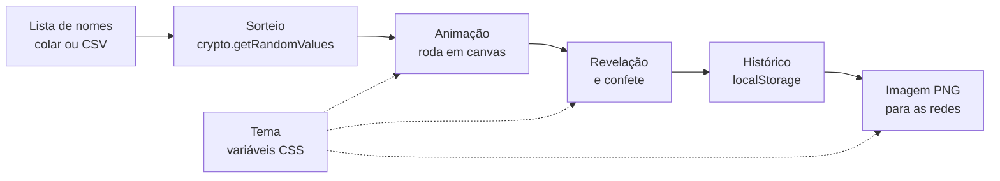

# Roteiro do Show & Tell: Sorteador do Auditório

**20/10/2026, 20h · uns 10 minutos**

Este é o roteiro da apresentação, não um texto para ler em voz alta. Cada parte
tem um tempo sugerido, os pontos que eu quero passar e o ato do
[diário](DIARIO.md) onde está a história completa.

| # | Parte | Tempo |
|---|---|---|
| 1 | Abertura e demo rápida | 1,5 min |
| 2 | Planejamento | 1 min |
| 3 | Ferramentas e arquitetura | 3,5 min |
| 4 | Desenvolvimento | 1,5 min |
| 5 | Desafios | 1,5 min |
| 6 | Aprendizados | 1 min |

---

## 1. Abertura e demo rápida (1,5 min)

Começar mostrando, não explicando. O gancho é ver funcionando.

- Abrir o sorteador na **página normal** e trocar o tema no seletor "Visual":
  **Clássico → Estúdio (Roda a Roda) → Manhã (Bom Dia & Cia)**. Parar no
  preferido. (O seletor fica escondido no modo apresentação, por isso a troca
  vem antes.)
- Clicar em **⛶ Modo apresentação** e fazer um sorteio completo: contagem 3-2-1,
  roda girando, nome revelado, confete.
- Sair do modo apresentação com **Esc**.
- Frase de passagem: *"Isso tudo é um arquivo HTML. Agora quero mostrar como
  ele foi feito, que é o que importa neste desafio."*

## 2. Planejamento (1 min)

- Comecei colando o desafio **inteiro** na IA, do jeito que chegou, e decidindo
  manter um diário. → [Ato 1](DIARIO.md#ato-1-o-ponto-de-partida)
- Roteiro em etapas: protótipo em HTML → código aberto no GitHub → layout com a
  comunidade → hospedagem → evoluir.
- **Um modo visual bem feito em vez de vários pela metade**, e o que ficou de
  fora escrito na hora. → [Ato 2](DIARIO.md#ato-2-protótipo-em-html-puro)
- Quando o desafio ganhou data, o plano virou uma **issue** com escopo e passos,
  e a decisão do que entrava ficou comigo. → [Ato 6](DIARIO.md#ato-6-o-desafio-ganha-data-e-a-tarefa-passa-para-outra-sessão)

## 3. Ferramentas e arquitetura (3,5 min)

### As ferramentas, e por quê

| Ferramenta | Para quê |
|---|---|
| **Claude Code** | A IA que escreve, testa e explica o código, no terminal. |
| **GitHub** (e o `gh` no terminal) | Código aberto, issues como plano, PR da comunidade. |
| **Chrome sem janela** | A IA tira capturas de tela para **provar** que ficou certo. |
| **Leonardo.ai** | Gerar a foto do boneco, onde o código chegou no limite. |

**Por que o Claude Code:** porque já é a ferramenta que eu uso no dia a dia, e
o desafio era mostrar como eu realmente trabalho, não testar ferramenta nova.

### A arquitetura: abrindo o capô

- **Um arquivo só, sem framework e sem build.** Abre com dois cliques e
  qualquer iniciante lê o código todo. Foi uma escolha didática, não uma
  limitação.
- **Decidir primeiro, animar depois.** O vencedor é sorteado **antes** de a roda
  girar; a animação só sabe onde parar. → [Ato 2](DIARIO.md#ato-2-protótipo-em-html-puro)
- **Aleatoriedade de verdade:** `crypto.getRandomValues`, e não `Math.random`,
  sem o viés do módulo, testado com 1,7 milhão de sorteios. Curiosidade: as
  lâmpadas de lava da Cloudflare.
- **Tema = um bloco de variáveis CSS.** A roda, o confete e a imagem leem as
  mesmas variáveis. Por isso, três temas couberam num dia. → [Ato 9](DIARIO.md#ato-9-três-temas-e-o-passo-que-não-muda-nada)
- **Tudo fica no navegador:** histórico e tema no `localStorage`, imagem
  desenhada em canvas.

### As regras por baixo dos panos (os diagramas)

O código foi escrito pela IA, e eu não vou lembrar dele linha por linha. O que
eu preciso saber, e o que quero ensinar, são as **regras** que não podem ser
quebradas. Mostrar dois diagramas do [COMO-FUNCIONA.md](COMO-FUNCIONA.md):

1. **Um sorteio, do clique ao confete** (diagrama de sequência): apontar a nota
   amarela, *"o vencedor está decidido; nada daqui para baixo muda isso"*, e a
   pegadinha do `Math.random` dentro da animação, que é só enfeite.
2. **Sortear sem viés** (fluxograma): o exemplo do gerador de 0 a 9 com 3
   nomes, em que o "9" que sobra dá vantagem ao primeiro. Por isso, descartar e
   sortear de novo.

Se sobrar tempo ou alguém perguntar: o terceiro, **trocar o tema**.
- **O que eu não fiz, e por quê: servidor.** Um servidor só se justifica para o
  que o navegador não faz (página pública de vencedores, sorteio verificável),
  e os nomes das pessoas viram dado pessoal (LGPD). Ficou como pergunta aberta
  para a comunidade. → [Ato 8](DIARIO.md#ato-8-o-servidor-fica-para-a-comunidade)

## 4. Desenvolvimento (1,5 min)

- **Não aceitar "está funcionando" como resposta: pedir prova.** Capturas de
  tela, medições, 1,7 milhão de sorteios. → [Ato 2](DIARIO.md#ato-2-protótipo-em-html-puro)
- **Protótipos de visual sem programação**, um arquivo por ideia, para comparar
  antes de mexer no sorteador. → [Ato 4](DIARIO.md#ato-4-definindo-o-visual-com-a-comunidade)
- **A issue como especificação e passagem de bastão** entre sessões da IA. →
  [Ato 6](DIARIO.md#ato-6-o-desafio-ganha-data-e-a-tarefa-passa-para-outra-sessão)
- **Um item por vez, como um humano**: reproduzir, corrigir, conferir, um commit
  pequeno, mostrar. Um robô faria tudo de uma vez, e ninguém conseguiria revisar.
  → [Ato 7](DIARIO.md#ato-7-aplicando-a-issue-como-um-aluno-um-item-por-vez)
- **O commit que não muda nada**, provado pixel a pixel, antes dos temas. →
  [Ato 9](DIARIO.md#ato-9-três-temas-e-o-passo-que-não-muda-nada)
- **A comunidade junto:** imagens de layout enviadas por participantes e o
  primeiro pull request. → [Atos 4 e 7](DIARIO.md#ato-4-definindo-o-visual-com-a-comunidade)

## 5. Desafios (1,5 min)

Mostrar os erros, que é o que a organização quer ver. Escolher dois ou três:

- **Imagem gerada por IA não é interface.** A montagem do quarto gamer tinha
  "Prêmio do me" e nomes embaralhados na roda. → [Ato 4](DIARIO.md#ato-4-definindo-o-visual-com-a-comunidade)
- **O boneco com cara de desenho animado.** Duas tentativas em código, e a
  solução foi trocar de ferramenta. → [Ato 5](DIARIO.md#ato-5-uma-proposta-minha-a-sala-do-jogo)
- **Luz piscando e epilepsia:** no máximo 3 piscadas por segundo. → [Ato 5](DIARIO.md#ato-5-uma-proposta-minha-a-sala-do-jogo)
- **O botão que sumia da tela**, inclusive em 1920×1080, e só a medição
  mostrou. → [Ato 7](DIARIO.md#ato-7-aplicando-a-issue-como-um-aluno-um-item-por-vez)
- **Quando o defeito era do teste, não do código**: três vezes. →
  [Atos 7, 9 e 10](DIARIO.md#ato-10-a-imagem-para-compartilhar-e-os-casos-extremos)
- **Os casos extremos:** o nome enorme espremido, vinte vencedores ilegíveis. →
  [Ato 10](DIARIO.md#ato-10-a-imagem-para-compartilhar-e-os-casos-extremos)

## 6. Aprendizados (1 min)

O que eu descobri (das lições do diário):

- Coloque o problema inteiro na mesa: a IA trabalha melhor com o contexto
  original do que com o seu resumo.
- Peça prova, não promessa.
- Quando o código chega no limite, troque de ferramenta.
- A conversa com a IA acaba; a issue fica.
- Devagar e um de cada vez: cada passo pequeno pode ser revisado por uma pessoa.
- Os defeitos moram nos extremos.

**O que eu faria diferente:**

- **Desenharia um fluxograma antes de sair programando.** Os diagramas do
  `COMO-FUNCIONA.md` vieram no fim, para explicar o que já existia; feitos
  antes, teriam guiado a IA desde o começo.
- Combinaria o ritmo "um item por vez" desde o primeiro dia, e não só no
  Ato 7.
- Guardaria as cores em variáveis desde o protótipo, sem precisar do passo de
  arrumação depois.
- Testaria em resolução de projetor desde o começo: o botão sumido só foi
  visto quando alguém mediu.
- Geraria a imagem do boneco antes de tentar desenhá-lo em código.

Mensagem final: *"A IA escreveu o código; o entendimento tem que ser meu. Por
isso o diário e os diagramas: eles guardam o que uma pessoa precisa saber
quando a IA não estiver olhando."*

Fechamento: *"Está tudo aberto no GitHub, com o diário. Quem quiser propor o
servidor (#3) ou o sorteio que o público consegue conferir (#4), as issues
estão esperando."*

---

## Números para citar

- 3 dias de trabalho (9, 10 e 12/10)
- 1 arquivo de ~1.200 linhas, sem nenhuma dependência para instalar
- 3 temas, 10 atos no diário
- 1,7 milhão de sorteios no teste de aleatoriedade
- 1 pull request da comunidade, 2 issues abertas para a comunidade continuar (#3 e #4)

## Checklist da demonstração

- [ ] Abrir o `index.html` no navegador do computador da apresentação
- [ ] Limpar o histórico antes de começar
- [ ] Testar o som na saída de áudio da chamada
- [ ] Modo apresentação na resolução do compartilhamento de tela (ensaiado em
      1280×720 e 1920×1080, nos três temas: tudo cabe na tela)
- [ ] Escolher o tema **antes** de entrar no modo apresentação
- [ ] Deixar o diário aberto numa aba, para mostrar um ato se perguntarem
