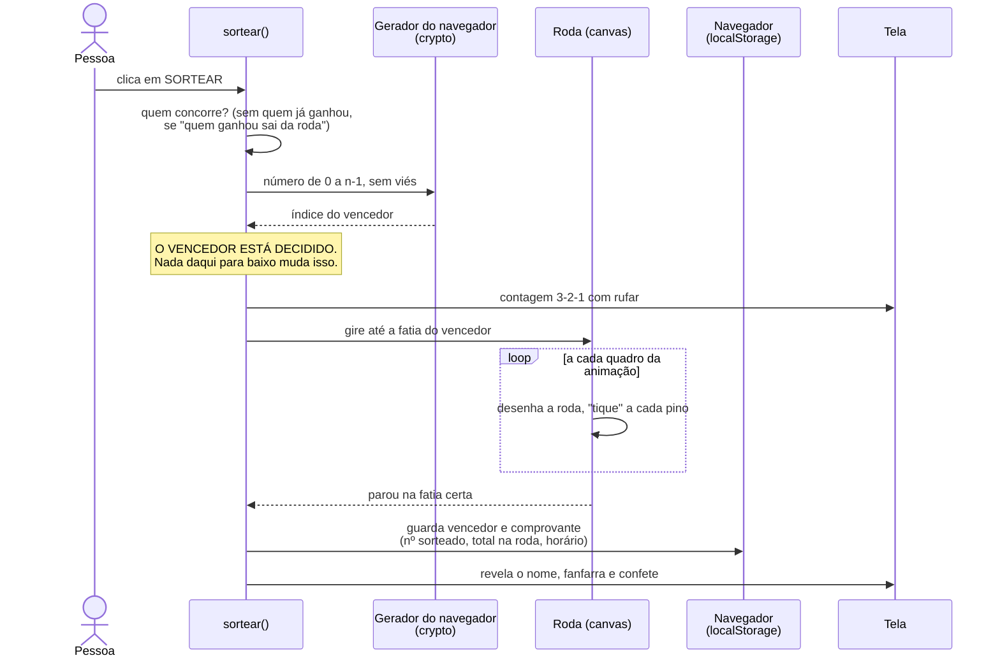
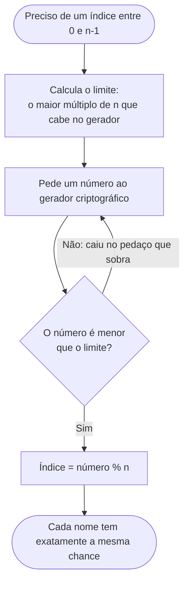
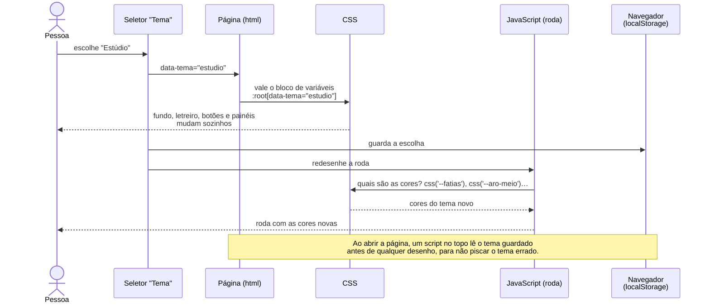
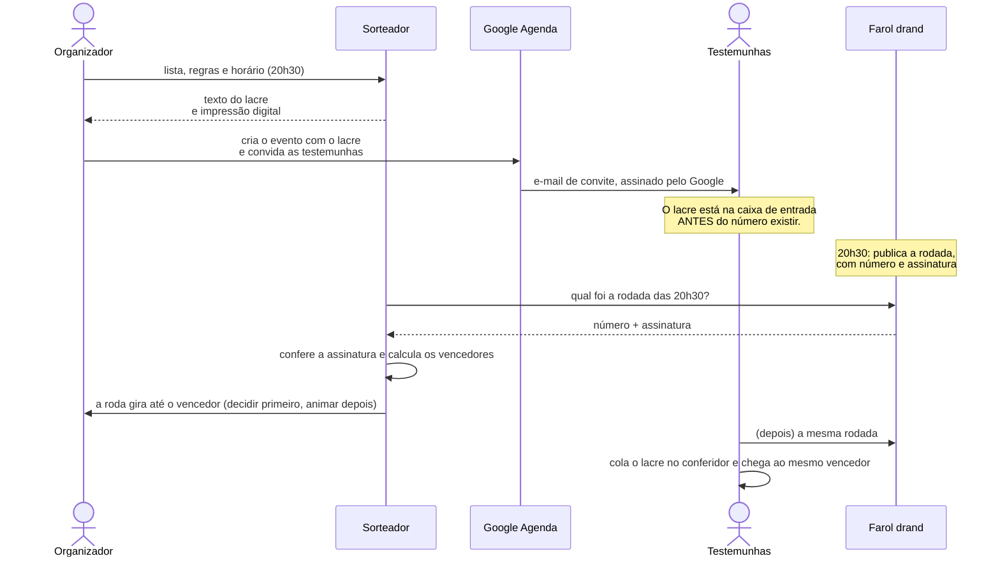
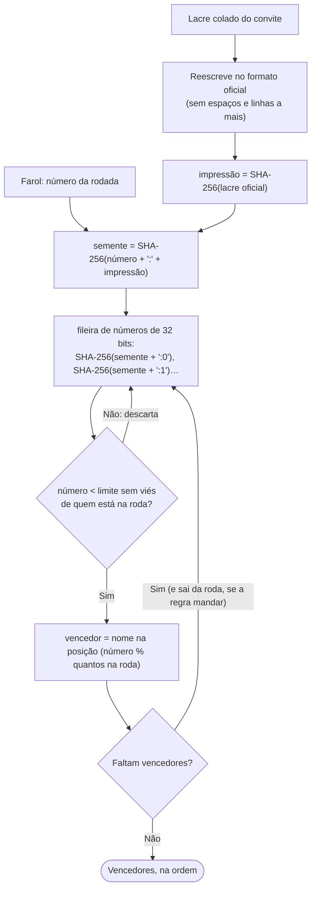
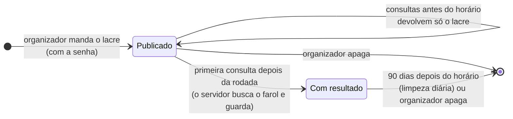

# Como o sorteador funciona por dentro

O código deste projeto foi escrito com IA. Quem não escreveu não lembra dele, e
nem precisa decorar cada linha. O que uma pessoa **precisa** entender são as
regras por baixo dos panos: as decisões que, se alguém mudar sem saber, quebram
o sorteio ou a confiança nele.

Cada diagrama abaixo mostra um processo, e logo depois vem **a regra** que ele
ensina e **onde ela está** no código (`index.html` e `regra-do-sorteio.js`).

---

## 1. Um sorteio, do clique ao confete

**As regras:**

- **Decidir primeiro, animar depois.** O acaso entra uma vez só, antes da
  animação. A roda recebe o resultado pronto e calcula onde parar. Se a física
  da animação decidisse, o resultado dependeria da velocidade do computador, e
  ninguém conseguiria provar que foi justo.
- **O `Math.random` dentro da animação é só enfeite.** Ele desloca o ponto de
  parada para não ser sempre o meio exato da fatia, mas sempre **dentro** da
  fatia sorteada. Trocar por `crypto` não melhora nada; usar `Math.random` para
  escolher o vencedor estragaria tudo.
- **O comprovante é registrado no mesmo momento do resultado**: número
  sorteado, quantos estavam na roda e horário. É o que permite conferir depois.

**Onde está:** `sortear()` comanda os passos; `participantesNaRoda()` decide
quem concorre; `inteiroAleatorio()` sorteia; `contagemRegressiva()`,
`girarAte()`, `revelar()` e `confete()` são o show; `salvarHistorico()` guarda.

---

## 2. Sortear sem viés

O gerador do navegador entrega números de 0 a 4.294.967.295. Para virar "um dos
n nomes", o jeito ingênuo é pegar o resto da divisão por n (`numero % n`). O
problema aparece num exemplo pequeno: imagine um gerador de **0 a 9** e **3
nomes**.

| Número | 0 | 1 | 2 | 3 | 4 | 5 | 6 | 7 | 8 | 9 |
|---|---|---|---|---|---|---|---|---|---|---|
| `numero % 3` | A | B | C | A | B | C | A | B | C | **A** |

A ganha em 4 números de 10; B e C, em 3. O "9" sobrou, e deu vantagem ao A. A
correção: **descartar o pedaço que sobra e sortear de novo**.

**As regras:**

- **`Math.random` não serve para sorteio.** Ele é previsível; o navegador
  oferece `crypto.getRandomValues`, alimentado por fontes de entropia do sistema
  operacional (a mesma ideia das lâmpadas de lava da Cloudflare).
- **Resto da divisão sozinho tem viés.** No gerador real o viés é minúsculo,
  mas existe, e num sorteio "minúsculo" não é "nenhum".
- **O laço quase nunca repete.** O pedaço descartado é muito pequeno perto de 4
  bilhões; na prática, o primeiro número quase sempre serve.

**Onde está:** `inteiroAleatorio(max)` e `limiteSemVies(max)`, no
`regra-do-sorteio.js`. O teste que confirmou a distribuição sorteou 1,7 milhão
de vezes entre 17 nomes; cada um saiu entre 99.309 e 100.559 vezes, para
100.000 esperadas. Ele roda de novo a cada mudança (`npm test`).

---

## 3. Trocar o tema

**As regras:**

- **Toda cor mora num bloco de variáveis CSS.** Nenhuma cor escrita direto no
  JavaScript: a roda, o confete e a imagem para as redes **perguntam** ao CSS.
  Por isso um tema novo é só um bloco a mais.
- **O que o CSS desenha muda sozinho; o que o canvas desenha precisa ser
  redesenhado.** O canvas é uma "foto": depois de pintado, não sabe que a cor
  mudou.
- **Mudar o visual não pode mudar o comportamento.** Ao criar os temas, cada
  passo foi conferido com capturas de tela comparadas pixel a pixel.

**Onde está:** o bloco `:root` no começo do `<style>` e os blocos
`:root[data-tema="..."]`; as funções `css()` e `listaCss()`; o evento de
`change` do seletor `#tema`.

---

## 4. O sorteio verificável: quem pode trapacear

O sorteio dos itens 1 e 2 é justo, mas o público precisa **acreditar** nisso:
o número nasce no computador do organizador e só ele o vê nascer. Nada impede
que ele sorteie dez vezes e mostre só o resultado de que gostou. O sorteio
verificável troca essa confiança por **conferência**: qualquer pessoa refaz a
conta e chega ao mesmo vencedor.

Antes de qualquer código, a pergunta foi: **quem pode trapacear, e como?**

| Trapaça | O que impede |
|---|---|
| Sortear várias vezes até sair quem ele quer | O acaso vem de um **farol público**, num horário futuro anunciado antes. Ninguém conhece o número antes da hora, nem o organizador |
| Escolher uma "semente" a dedo | Ninguém escolhe a semente: ela sai do número do farol |
| Mexer na lista depois de ver o número | A lista vai no **lacre**, entregue às testemunhas antes do horário |
| Inflar as chances com nomes repetidos | A lista inteira fica à vista no lacre, já sem os repetidos |
| Mostrar um sorteio e esconder outro | O lacre é público e as testemunhas comparam o que receberam com o que veem na tela |
| Alterar o lacre depois de enviado | O lacre que vale é o **e-mail** que chegou, e não um arquivo ou evento que dá para editar |
| O nosso servidor mentir o número do farol | O farol **assina** cada número, e o navegador de quem confere verifica a assinatura |
| O nosso código fazer a conta errada de propósito | A regra é pública e simples, e existe um conferidor independente que qualquer um pode rodar |

### O lacre e o farol

O **farol** é o [drand](https://drand.love), mantido pela League of Entropy,
um grupo de organizações (a Cloudflare das lâmpadas de lava é uma delas). A
cada 3 segundos ele publica uma **rodada**: um número aleatório numerado e
assinado, que nunca muda depois de publicado. Cada horário corresponde a uma
rodada, então "o sorteio das 20h30" já diz qual número vai ser usado.

O **lacre** é um texto com tudo o que decide o resultado: a lista de
participantes, as regras e o horário. Ele é entregue às testemunhas **antes**
do horário. O jeito mais simples é colá-lo na descrição de um evento do Google
Agenda e convidar as testemunhas.

**As regras:**

- **O lacre chega antes do número.** É isso que dá valor à prova. Quem recebeu
  o lacre depois do horário continua podendo conferir a conta, mas não tem como
  saber se a lista não foi trocada.
- **O lacre que vale é o e-mail, não o evento.** O organizador pode editar o
  evento na agenda, inclusive sem avisar os convidados. O e-mail de convite que
  chegou não muda, e vem assinado pelo Google, que nem o organizador nem o
  projeto conseguem falsificar.
- **A agenda carrega o lacre, mas não gera o acaso.** Se o acaso viesse do
  evento, o organizador poderia apagar e criar de novo até gostar do resultado.
- **Farol fora do ar: o sorteio é adiado.** O modo verificável nunca troca o
  farol pelo gerador do navegador sem avisar. Um sorteio "verificável" que
  caiu em silêncio para o modo comum seria pior que nenhum.
- **Quem confere usa o próprio navegador.** O conferidor busca o número no
  farol, confere a assinatura e refaz a conta sozinho, sem perguntar nada ao
  servidor do projeto.
- **A roda confere a regra.** Antes de girar, o sorteador confere se o nome
  que vai parar no ponteiro é o mesmo que a regra calculou. Se um dia
  discordarem, o sorteio para com um erro, em vez de mostrar um vencedor que o
  conferidor não confirmaria.

**Onde está:** no `index.html`, a seção "SORTEIO VERIFICÁVEL" (`lacrar()`,
`proximoDoFarol()`, `linkDaAgenda()`); a busca e a conferência da assinatura no
`farol.js`; o conferidor no `conferir.html` e no `conferir.mjs`.

### O que isto NÃO protege

Um sistema honesto diz onde a proteção acaba. Este não resolve:

- **Um conluio do organizador com todas as testemunhas.** Se todo mundo que
  recebeu o lacre combinar de mentir, não sobra ninguém para conferir.
- **Dois eventos escondidos.** O organizador pode criar dois lacres para dois
  grupos diferentes e mostrar o que convier. Mostrar o lacre na tela durante a
  live diminui o risco, mas não elimina.
- **O próprio farol.** Se a maioria das organizações que mantém o drand se
  unir para trapacear, a garantia acaba. É uma aposta parecida com a que
  fazemos todo dia no cadeado do HTTPS.
- **Quem não confere.** Verificável não é o mesmo que verificado. A prova só
  existe para quem lê o lacre e roda o conferidor.

---

## 5. Do número do farol aos vencedores

A regra é pública e cabe em poucas linhas, para que qualquer pessoa consiga
repetir a conta em qualquer linguagem. Para provar isso, ela foi escrita duas
vezes: em JavaScript (`regra-do-sorteio.js`) e em Python
(`testes/segunda-implementacao.py`, escrita só a partir desta descrição). As
duas chegam aos mesmos vencedores em todos os vetores de teste.

**A regra, passo a passo:**

1. **O lacre no formato oficial.** Cada linha é limpa (acentos no padrão NFC,
   sem caracteres invisíveis, espaços repetidos viram um só, sem espaço nas
   pontas), as linhas vazias saem, e ficam só as linhas do cabeçalho
   `SORTEIO VERIFICÁVEL (versão 1)` até o último participante, unidas por
   quebra de linha. É por isso que um lacre copiado "sujo" de um convite dá a
   mesma impressão digital.
2. **Impressão digital:** SHA-256 do lacre oficial, em hexadecimal minúsculo.
3. **Semente:** SHA-256 do texto `aleatoriedade:impressão`, em que
   `aleatoriedade` é o campo `randomness` da rodada do farol, em hexadecimal.
4. **Fileira de números:** SHA-256 de `semente:0` dá 32 bytes, lidos de 4 em 4
   como números de 32 bits (big-endian); depois `semente:1`, e assim por
   diante.
5. **Cada vencedor:** com `n` nomes na roda, descarta os números a partir de
   `⌊2³² / n⌋ × n` (o mesmo descarte do item 2) e usa `número % n` como
   posição na roda. Se quem ganhou sai da roda, o nome é retirado e os outros
   mantêm a ordem.

**As regras:**

- **Tudo vira texto antes do SHA-256.** Assim a conta não depende de detalhes
  de uma linguagem, como a ordem dos bytes de um número.
- **A impressão digital entra na semente.** O mesmo número do farol, com uma
  lista diferente, dá vencedores diferentes: o resultado fica preso àquele
  lacre.
- **Mudou a regra, mudou a versão.** O cabeçalho diz `versão 1`. Qualquer
  mudança nesta conta exige uma `versão 2`, senão os lacres antigos deixariam
  de conferir.

**Onde está:** `regra-do-sorteio.js` (`escreverLacre`, `lerLacre`,
`impressaoDigital`, `semente`, `numerosDaSemente`, `sortearComSemente`). Os
casos de teste estão em `testes/vetores.json`, com rodadas reais do drand.

---

## 6. O servidor: um endereço para cada sorteio

O sorteio verificável funciona sem servidor. O servidor existe só para dar a
cada sorteio um **endereço público** (`/s/<código>`), que quem assiste abre
pelo celular. As decisões estão em [`docs/decisoes/`](docs/decisoes/).

**As regras:**

- **O servidor não precisa ser confiável.** Ele guarda e devolve o lacre, e
  calcula o resultado por conveniência. Quem confere de verdade é o
  navegador de quem olha, com o farol e a regra.
- **Lacre de rodada que já saiu é recusado**, como no sorteador: quem
  publicasse poderia conhecer o resultado antes.
- **O mesmo lacre publicado duas vezes é o mesmo sorteio** (a impressão
  digital é única no banco).
- **O servidor publica por lista de permitidos.** Os arquivos estáticos saem
  da raiz do repositório, mas só os listados no `.assetsignore`. Um arquivo
  novo na raiz nasce escondido, e não público.
- **Só o organizador grava ou apaga**, com uma senha guardada como segredo do
  servidor. São 10 tentativas por minuto por endereço de internet; a
  comparação da senha leva sempre o mesmo tempo, acertando ou errando.
- **Nada além do lacre é guardado:** nenhum e-mail, IP ou cookie. E tudo some
  90 dias depois do horário do sorteio.

**Onde está:** `servidor/index.js` (as rotas, `publicar()`, `consultar()`,
`exigirOrganizador()` e a limpeza em `scheduled()`), a tabela em
`servidor/migracoes/0001_sorteios.sql`, a configuração em `wrangler.jsonc` e
os testes em `testes/servidor.test.mjs`.

---

## Quando o código mudar

Estes diagramas descrevem o código de 19/10/2026. Se uma dessas regras mudar,
o diagrama tem que mudar no mesmo commit; diagrama desatualizado ensina errado.
