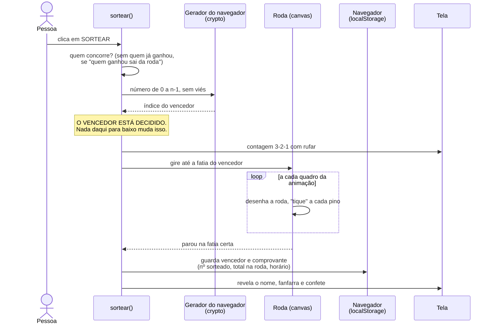
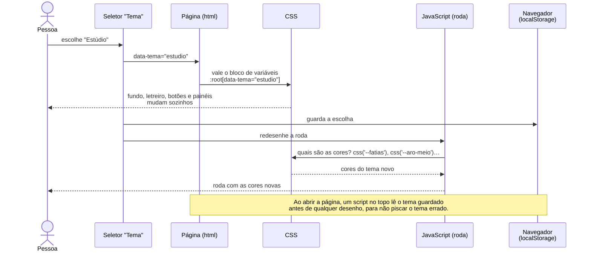

# Como o sorteador funciona por dentro

O código deste projeto foi escrito com IA. Quem não escreveu não lembra dele, e
nem precisa decorar cada linha. O que uma pessoa **precisa** entender são as
regras por baixo dos panos: as decisões que, se alguém mudar sem saber, quebram
o sorteio ou a confiança nele.

Cada diagrama abaixo mostra um processo, e logo depois vem **a regra** que ele
ensina e **onde ela está** no `index.html`.

---

## 1. Um sorteio, do clique ao confete

**As regras:**

- **Decidir primeiro, animar depois.** O acaso entra uma vez só, antes da
  animação. A roda recebe o resultado pronto e calcula onde parar. Se a física
  da animação decidisse, o resultado dependeria da velocidade do computador, e
  ninguém conseguiria provar que foi justo.
- **O `Math.random` dentro da animação é só enfeite.** Ele desloca o ponto de
  parada para não ser sempre o meio exato da fatia, mas sempre **dentro** da
  fatia sorteada. Trocar por `crypto` não melhora nada; usar `Math.random` para
  escolher o vencedor estragaria tudo.
- **O comprovante é registrado no mesmo momento do resultado**: número
  sorteado, quantos estavam na roda e horário. É o que permite conferir depois.

**Onde está:** `sortear()` comanda os passos; `participantesNaRoda()` decide
quem concorre; `inteiroAleatorio()` sorteia; `contagemRegressiva()`,
`girarAte()`, `revelar()` e `confete()` são o show; `salvarHistorico()` guarda.

---

## 2. Sortear sem viés

O gerador do navegador entrega números de 0 a 4.294.967.295. Para virar "um dos
n nomes", o jeito ingênuo é pegar o resto da divisão por n (`numero % n`). O
problema aparece num exemplo pequeno: imagine um gerador de **0 a 9** e **3
nomes**.

| Número | 0 | 1 | 2 | 3 | 4 | 5 | 6 | 7 | 8 | 9 |
|---|---|---|---|---|---|---|---|---|---|---|
| `numero % 3` | A | B | C | A | B | C | A | B | C | **A** |

A ganha em 4 números de 10; B e C, em 3. O "9" sobrou, e deu vantagem ao A. A
correção: **descartar o pedaço que sobra e sortear de novo**.

**As regras:**

- **`Math.random` não serve para sorteio.** Ele é previsível; o navegador
  oferece `crypto.getRandomValues`, alimentado por fontes de entropia do sistema
  operacional (a mesma ideia das lâmpadas de lava da Cloudflare).
- **Resto da divisão sozinho tem viés.** No gerador real o viés é minúsculo,
  mas existe, e num sorteio "minúsculo" não é "nenhum".
- **O laço quase nunca repete.** O pedaço descartado é muito pequeno perto de 4
  bilhões; na prática, o primeiro número quase sempre serve.

**Onde está:** `inteiroAleatorio(max)`, com 8 linhas. O teste que confirmou a
distribuição sorteou 1,7 milhão de vezes entre 17 nomes; cada um saiu entre
99.309 e 100.559 vezes, para 100.000 esperadas.

---

## 3. Trocar o tema

**As regras:**

- **Toda cor mora num bloco de variáveis CSS.** Nenhuma cor escrita direto no
  JavaScript: a roda, o confete e a imagem para as redes **perguntam** ao CSS.
  Por isso um tema novo é só um bloco a mais.
- **O que o CSS desenha muda sozinho; o que o canvas desenha precisa ser
  redesenhado.** O canvas é uma "foto": depois de pintado, não sabe que a cor
  mudou.
- **Mudar o visual não pode mudar o comportamento.** Ao criar os temas, cada
  passo foi conferido com capturas de tela comparadas pixel a pixel.

**Onde está:** o bloco `:root` no começo do `<style>` e os blocos
`:root[data-tema="..."]`; as funções `css()` e `listaCss()`; o evento de
`change` do seletor `#tema`.

---

## Quando o código mudar

Estes diagramas descrevem o código de 12/10/2026. Se uma dessas regras mudar,
o diagrama tem que mudar no mesmo commit; diagrama desatualizado ensina errado.
